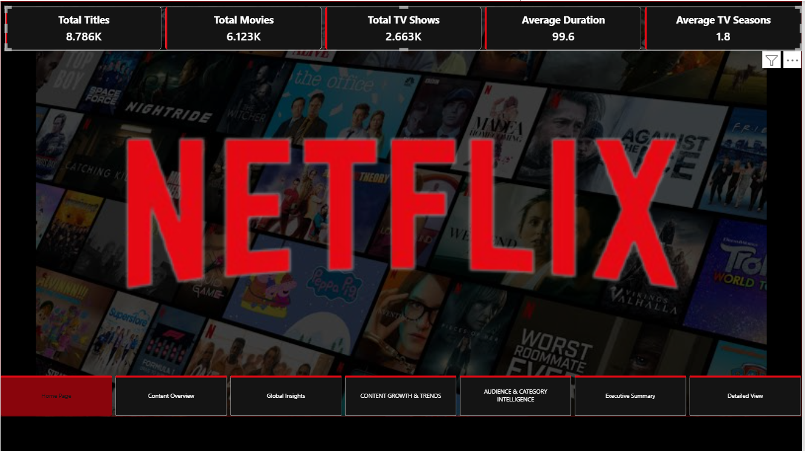
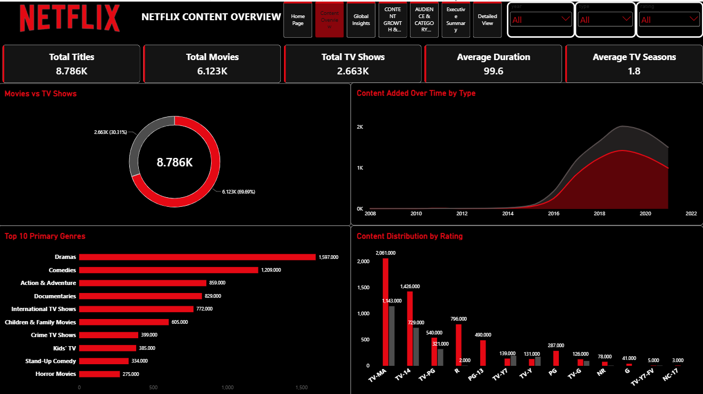
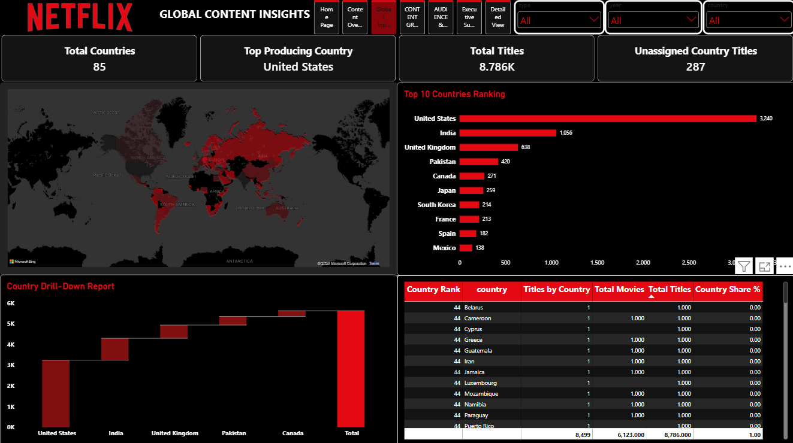
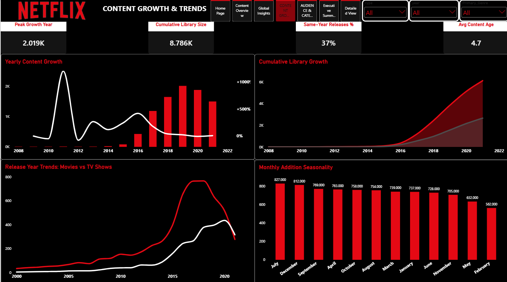
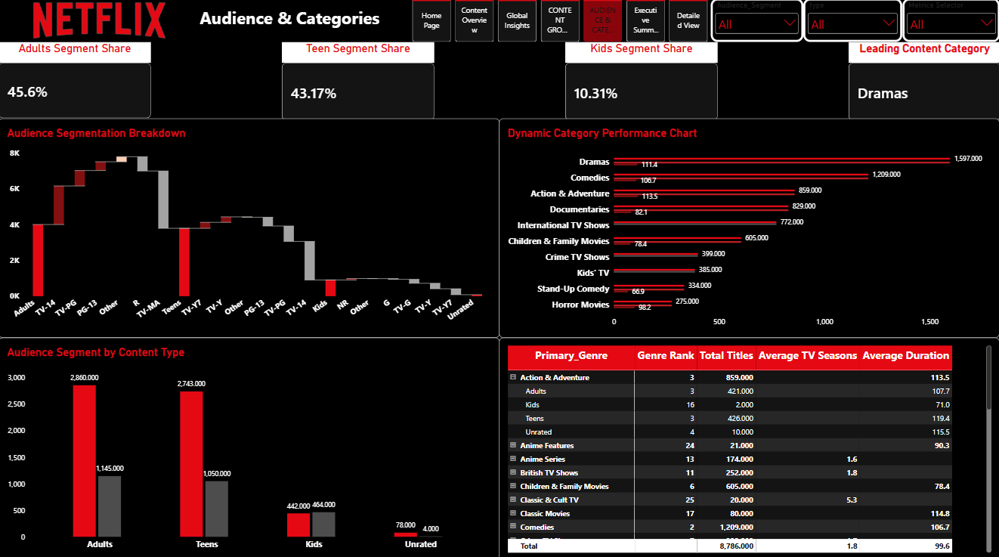
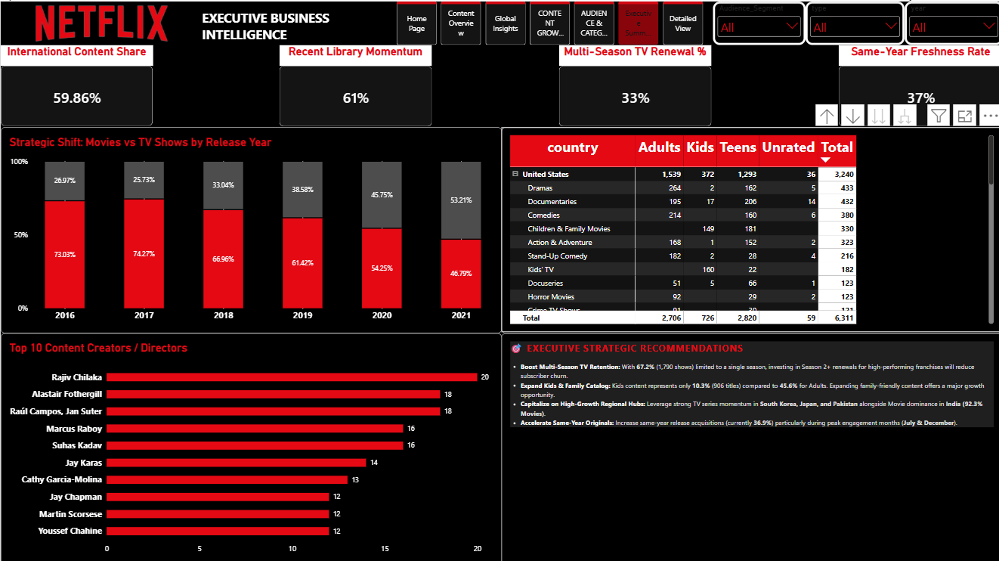
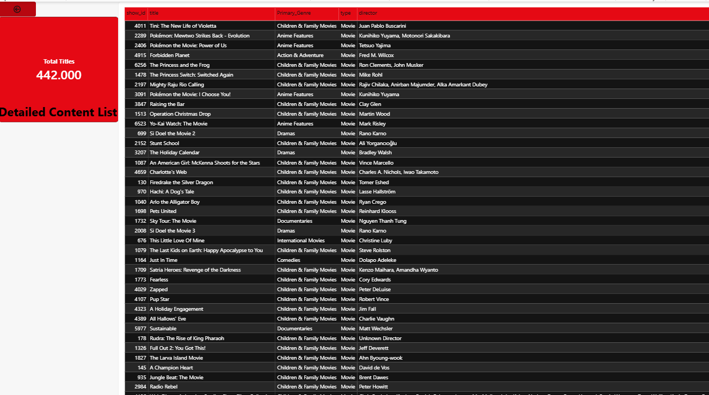

# 🎬 Netflix Executive Business Intelligence Dashboard (CSV to Dashboard)

<p align="center">
  
</p>

## 📌 Problem Statement

Raw streaming catalog datasets—such as the Netflix Titles CSV (`8,790` records)—present significant analytical and structural barriers when ingested directly into Business Intelligence tools without rigorous preprocessing and data modeling:
1. **Hidden Data Quality Defects:** Although automated column profiling shows `0%` null/blank cells, `2,588` director entries (`29.4%`) and `287` country entries (`3.3%`) are masked with the placeholder string `"Not Given"`, severely skewing top-creator rankings and geographic maps.
2. **Spreadsheet Formatting Corruption & Duplicates:** Calendar-like movie titles were auto-converted by Excel into date strings (`"22-Jul"`, `"15-Aug"`, `"9-Feb"`), and identical catalog entries appear multiple times under divergent `show_id` keys (`8,790` raw rows vs. `8,786` unique titles).
3. **Heterogeneous & Non-Atomic Fields:**
   - The `duration` column mixes incompatible measurement units in a single text field (`"90 min"` for Movies vs. `"1 Season"` / `"2 Seasons"` for TV Shows), blocking numeric aggregations.
   - The `listed_in` (genres) and `director` columns store comma-delimited multi-valued lists (`513` unique genre combinations), violating First Normal Form (1NF).
   - The `date_added` field is stored as US-formatted text (`M/d/yyyy`), which causes locale conversion crashes on non-US regional settings and prevents time-intelligence calculations.
   - Maturity ratings contain redundant codes (`NR` vs. `UR`) and lack high-level demographic groupings (Adults, Teens, Kids).

**Objective:** Transform the raw `Dataset.csv` into an interactive, multi-page **Netflix Executive Power BI Dashboard** (`Netflix_Executive_Dashboard.pbix`) that resolves all data integrity issues, establishes a scalable Star/Bridge data model, and delivers actionable executive insights across content overview, geographic distribution, temporal growth, audience segmentation, and strategic decision-making.

---

## 📊 Dataset Details

- **Source File:** `Dataset.csv/Dataset.csv`
- **Raw Volume:** `8,790` records across `10` columns (`8,786` deduplicated unique catalog titles).
- **Temporal Coverage:** Release years spanning `1925–2021`; platform additions (`date_added`) spanning `2008–2021`.

### Schema & Anomaly Summary

| Column | Raw Type | Unique Values | Key Anomaly Identified | Resolution Strategy |
| :--- | :--- | :---: | :--- | :--- |
| **`show_id`** | Text | 8,790 | False primary key illusion (duplicate titles assigned different IDs) | Deduplicate on `title` + `type` + `release_year` |
| **`type`** | Text | 2 | Binary category (`Movie`, `TV Show`); requires whitespace trimming | `Text.Trim` + conditional metric branching |
| **`title`** | Text | 8,787 | Excel date corruption (`22-Jul`, `15-Aug`, `9-Feb`) & duplicate rows | Restore true titles (`22 July`, `15 August`, `9 February`) & deduplicate |
| **`director`** | Text | 4,528 | `2,588` masked missing rows (`"Not Given"`) + `629` multi-director comma strings | Reclassify `"Not Given"` $\rightarrow$ `"Unknown Director"` + split Bridge Table |
| **`country`** | Text | 86 | `287` masked missing rows (`"Not Given"`); lacks GIS geocoding category | Reclassify `"Not Given"` $\rightarrow$ `"Unknown Country"` + assign `Country/Region` GIS category |
| **`date_added`** | Text | 1,713 | Text string in `M/d/yyyy` format causing regional locale errors | Parse as `Date` using explicit `en-US` locale + link to `Dim_Date` calendar |
| **`release_year`** | Int64 | 74 | Auto-summed by Power BI as an additive fact | Disable default summarization (`Don't Summarize`) + compute Content Age |
| **`rating`** | Text | 14 | Redundant codes (`UR` vs. `NR`); technical TV/MPAA codes lack demographic context | Merge `UR` $\rightarrow$ `NR` + map into **Adults**, **Teens**, **Kids**, and **Unrated** |
| **`duration`** | Text | 220 | Mixed units (`min` vs. `Season`/`Seasons`) stored as text | Extract numeric value and split into `Movie_Duration_Min` & `TV_Seasons_Count` |
| **`listed_in`** | Text | 513 | Comma-separated multi-genre strings violating 1NF | Extract `Primary_Genre` + normalize via Genre Bridge Table |

---

## 🛠️ Approach

### 1. Forensic Data Quality Audit (`generate_report.py`)
- Built an automated Python audit and PDF report generator (`generate_report.py`) using `ReportLab` to document column-level anomalies, severity levels, Power Query (M) transformation scripts, and DAX formulas prior to dashboard construction.

### 2. ETL & Data Cleaning in Power Query (M)
- **Text Sanitization & Title Repair:** Applied `Text.Trim` across all text attributes and restored Excel-corrupted movie titles (`"22-Jul"` $\rightarrow$ `"22 July"`, `"15-Aug"` $\rightarrow$ `"15 August"`, `"9-Feb"` $\rightarrow$ `"9 February"`).
- **Catalog Deduplication:** Removed duplicate catalog items across `{title, type, release_year}`, arriving at `8,786` clean titles (`6,123` Movies and `2,663` TV Shows).
- **Missing Value Standardization:** Replaced `"Not Given"` placeholders with explicit `"Unknown Director"` and `"Unknown Country"` labels so visual filters can cleanly isolate or exclude unassigned records (`287` unassigned country titles tracked via a dedicated KPI card).
- **Locale-Safe Date Parsing:** Converted `date_added` to `type date` using `"en-US"` locale rules.
- **Metric Separation & Feature Engineering:**
  - Extracted numeric duration values and split them conditionally by `type` into `Movie_Duration_Min` (Minutes) and `TV_Seasons_Count` (Seasons).
  - Extracted `Primary_Genre` (the leading genre before the first comma delimiter) for clean top-level category reporting.
  - Standardized `UR` into `NR` and grouped ratings into four core **Audience Segments**:
    - **Adults:** `TV-MA`, `R`, `NC-17`
    - **Teens:** `TV-14`, `PG-13`, `TV-PG`, `PG`
    - **Kids:** `TV-Y7`, `TV-Y`, `TV-G`, `G`, `TV-Y7-FV`
    - **Unrated:** `NR`

### 3. Data Modeling & DAX Measures
- **Star & Bridge Architecture:** Connected the cleaned catalog fact table to a dedicated calendar dimension (`Dim_Date`) and normalized multi-valued attributes for drill-down analysis.
- **Executive DAX Library:** Engineered custom DAX KPIs including:
  - *Core Volume & Format Split:* `Total Titles`, `Total Movies`, `Total TV Shows`, `Average Duration` (mins), `Average TV Seasons`.
  - *Geographic Metrics:* `Total Countries`, `Top Producing Country`, `Unassigned Country Titles`, `Country Rank`, `Country Share %`, `International Content Share`.
  - *Growth & Freshness Intelligence:* `Peak Growth Year`, `Cumulative Library Size`, `Same-Year Releases %` (`37%`), `Avg Content Age` (`4.7` years), `Recent Library Momentum` (`61%`), and `Multi-Season TV Renewal %` (`33%`).

### 4. UI/UX Design & Custom Branding (`Netflix_Theme.json`)
- Applied a custom **Netflix Dark UI** theme (`#141414` background, `#E50914` Netflix Crimson accents, `#564D4D` / `#221F1F` secondary tones, `#FFFFFF` foreground typography).
- Designed a **7-page interactive application** with top-bar page navigation buttons, dynamic slicers (`Year`, `Type`, `Rating`, `Country`, `Primary_Genre`, `Audience_Segment`, `Metric Selector`), and a dedicated **Detailed Content Drill-Through** view.

---

## 📈 Results & Dashboard Insights

### 1. Home Page & Navigation Hub
<p align="center">
  
</p>

- **Top-Level Catalog KPIs:**
  - **Total Titles:** `8,786` (`8.786K`)
  - **Total Movies:** `6,123` (`69.69%` of catalog)
  - **Total TV Shows:** `2,663` (`30.31%` of catalog)
  - **Average Movie Duration:** `99.6` minutes
  - **Average TV Show Length:** `1.8` seasons

---

### 2. Content Overview
<p align="center">
  
</p>

- **Format Split:** Movies dominate the library at **69.69%** (`6,123` titles) vs. **30.31%** (`2,663` titles) for TV Shows.
- **Top Primary Genres:** **Dramas** (`1,597`), **Comedies** (`1,209`), **Action & Adventure** (`859`), **Documentaries** (`829`), and **International TV Shows** (`772`) account for the largest catalog shares.
- **Maturity Rating Distribution:** **TV-MA** (`2,061` Movies / `1,143` TV Shows) and **TV-14** (`1,426` Movies / `729` TV Shows) are the two dominant maturity ratings across both formats.

---

### 3. Global Content Insights
<p align="center">
  
</p>

- **Global Footprint:** Content originates from **85 known countries**, with **287 titles** isolated under `Unassigned Country Titles`.
- **Top Producing Countries:**
  1. **United States:** `3,240` titles (`~36.9%` of total catalog)
  2. **India:** `1,056` titles
  3. **United Kingdom:** `638` titles
  4. **Pakistan:** `420` titles
  5. **Canada:** `271` titles
  6. **Japan (`259`)**, **South Korea (`214`)**, **France (`213`)**, **Spain (`182`)**, and **Mexico (`138`)** round out the Top 10.

---

### 4. Content Growth & Trends
<p align="center">
  
</p>

- **Peak Expansion:** **2019** was Netflix's peak catalog addition year, followed closely by 2020 and 2018, with rapid exponential growth starting in **2016**.
- **Catalog Freshness & Age:** **37%** of titles are added to Netflix in the same year as their original release, and the average content age across the library is **4.7 years**.
- **Monthly Addition Seasonality:** **July (`827`)** and **December (`812`)** are peak months for new content additions, aligning with summer and holiday viewing surges, while **February (`562`)** sees the lowest volume.

---

### 5. Audience & Category Intelligence
<p align="center">
  
</p>

- **Demographic Breakdown:**
  - **Adults (`45.6%`):** `2,860` Movies and `1,145` TV Shows.
  - **Teens (`43.17%`):** `2,743` Movies and `1,050` TV Shows.
  - **Kids (`10.31%`):** `442` Movies and `464` TV Shows (the only demographic segment where TV Shows outnumber Movies).
- **Category Runtime & Season Benchmarks:** Classic Movies (`114.8 min`), Action & Adventure (`113.5 min`), and Dramas (`111.4 min`) have the longest average movie runtimes, while Stand-Up Comedy (`66.9 min`) and Children & Family Movies (`78.4 min`) are the shortest.

---

### 6. Executive Business Intelligence & Strategic Recommendations
<p align="center">
  
</p>

- **Executive KPIs:**
  - **International Content Share:** `59.86%` (non-US productions represent nearly 60% of the catalog).
  - **Recent Library Momentum:** `61%` of the catalog was added in the most recent peak expansion window.
  - **Multi-Season TV Renewal Rate:** Only **33%** of TV series reach 2+ seasons (`67.2%` or `1,790` shows have only a single season).
  - **Strategic Shift (Movies vs. TV Shows by Release Year):** For recent releases (`2016` $\rightarrow$ `2021`), the share of TV Shows surged from **26.97%** (2016) to **53.21%** (2021), overtaking Movies (`46.79%`) among newly released titles.
  - **Top Content Creators / Directors:** **Rajiv Chilaka** (`20` titles), **Alastair Fothergill** (`18`), **Raúl Campos & Jan Suter** (`18`), **Marcus Raboy** (`16`), and **Suhas Kadav** (`16`).
- **Strategic Recommendations Highlighted on the Dashboard:**
  1. **Boost Multi-Season TV Retention:** With `67.2%` (`1,790` shows) limited to a single season, investing in Season 2+ renewals for high-performing franchises will reduce subscriber churn.
  2. **Expand Kids & Family Catalog:** Kids content represents only `10.3%` (`906` titles) compared to `45.6%` for Adults—representing a high-value family acquisition opportunity.
  3. **Capitalize on High-Growth Regional Hubs:** Leverage strong TV series momentum in **South Korea, Japan, and Pakistan** alongside Movie dominance in **India** (`92.3%` Movies).
  4. **Accelerate Same-Year Originals:** Increase same-year release acquisitions (currently `36.9%` / `37%`), particularly during peak engagement months (**July** and **December**).

---

### 7. Detailed View (Drill-Through Page)
<p align="center">
  
</p>

- Provides granular record-level inspection (`show_id`, `title`, `Primary_Genre`, `type`, `director`) dynamically filtered from any visual across the report (shown above drilled into `442` Kids Movies).

---

## 📁 Repository Structure

```text
Task 4 CSV to Dashboard/
├── Dataset.csv/
│   └── Dataset.csv                          # Raw Netflix catalog dataset (8,790 records)
├── Netflix_Executive_Dashboard.pbix/
│   └── Netflix_Executive_Dashboard.pbix.pbix # Interactive Power BI Dashboard file
├── Netflix_Theme.json/
│   └── Netflix_Theme.json.json              # Custom Netflix Dark UI theme for Power BI
├── Screenshots/                             # High-resolution dashboard page exports
│   ├── 0_Home_Page.png.png
│   ├── 01_Content_Overview.png.png
│   ├── 02_Global_Insights.png.png
│   ├── 03_Growth_and_Trends.png.png
│   ├── 04_Audience_and_Categories.png.png
│   ├── 05_Executive_Summary.png.png
│   └── 06_Detailed_Drill_Through.png.png
├── generate_report.py                       # Automated Data Quality Audit & Power BI Solution PDF generator
├── Github.txt                               # Repository reference link
└── README.md                                # Project documentation
```
