<div align="center">
  
  <h1>Netflix Exploratory Data Analysis (EDA)</h1>
  <p><strong>Synent Technologies — Data Science Internship (Task 3)</strong></p>
  <p>
    <strong>Author:</strong> Ahmed Mahmoud Khalifa &nbsp;|&nbsp;
    <strong>Track:</strong> Data Science &nbsp;|&nbsp;
    <strong>GitHub:</strong> <a href="https://github.com/ahmedmahmoudkhalifa300">@ahmedmahmoudkhalifa300</a> &nbsp;|&nbsp;
    <strong>Repository:</strong> <a href="https://github.com/ahmedmahmoudkhalifa300/Synent-Technologies/tree/main/Task3_Netflix_EDA">Synent-Technologies / Task3_Netflix_EDA</a>
  </p>
</div>

---

## 📌 Project Overview

This repository delivers an end-to-end, rigorous, and reproducible **Exploratory Data Analysis (EDA)** of the Netflix content catalog snapshot. The project evaluates content distributions, catalog acquisition dynamics, global representation, duration characteristics, temporal genre shifts across release eras, and numeric correlations.

---

## 🎯 Problem Statement

Streaming platforms operate in an intensely competitive digital entertainment landscape where content acquisition, licensing strategies, and regional diversification dictate platform value. Understanding catalog composition and evolution requires answering critical questions:

1. **Catalog Composition:** What is the balance between feature films and serialized television shows, and how do maturity ratings distribute across content types?
2. **Temporal Acquisition vs. Production:** How has Netflix's rate of catalog additions changed over time (`date_added`), and how does addition timing relate to original production eras (`release_year`)?
3. **Geographic Distribution:** Which countries dominate production, and what is the extent of international market representation?
4. **Duration & Structure:** What are the distribution profiles of film runtimes (in minutes) and TV show lifespans (in seasons), and do these parameters shift across eras?
5. **Decadal Genre Shifts:** How did content genre prevalence evolve across release decades, particularly between vintage titles and modern streaming catalog additions?
6. **Empirical Associations:** Do meaningful correlations exist among continuous and discrete numeric features (release year, addition year, movie runtimes, season counts) without resorting to artificial encoding of nominal variables?

> **⚠️ Analytical Scope & Limitation:**  
> The dataset represents a catalog snapshot and **does not contain viewership counts, user ratings, completion rates, or streaming minutes**. Consequently, all genre frequencies and content counts describe **catalog availability and prevalence**, not audience popularity or viewer preference. Furthermore, statistical associations describe observational patterns and **do not establish causation**.

---

## 📊 Dataset Details

The analysis operates on `Dataset.csv`, reflecting a verified snapshot of the Netflix streaming library.

| Property | Description |
|---|---|
| **Raw Records** | `8,790` rows |
| **Columns** | `10` features |
| **Cleaned Records** | `8,790` rows (no rows dropped; raw copy strictly preserved) |
| **Observed Schema** | `show_id`, `type`, `title`, `director`, `country`, `date_added`, `release_year`, `rating`, `duration`, `listed_in` |
| **Source File** | `data/raw/Dataset.csv` |
| **Cleaned Export** | `data/processed/netflix_cleaned.csv` |

### Data Dictionary & Feature Engineering Summary

| Feature | Raw Type | Cleaned Type | Description & Engineering Approach |
|---|---|---|---|
| `show_id` | `object` | `string` | Unique identifier per catalog entry (`s1` to `s8790`). Verified unique key. |
| `type` | `object` | `string` | Binary categorization: `Movie` ($69.7\%$) vs `TV Show` ($30.3\%$). |
| `title` | `object` | `string` | Title of the production. Preserved without deduplication of distinct IDs. |
| `director` | `object` | `string` | Director name(s). Converted placeholder `"Not Given"` ($2,588$ titles) to explicit unknown category. Exploded for frequency analysis. |
| `country` | `object` | `string` | Production country. Exploded multi-country listings; mapped missing/`"Not Given"` ($287$ titles) to `"Unknown / Not Given"`. |
| `date_added` | `object` | `datetime64` | Date catalog entry was ingested. Parsed via explicit `%m/%d/%Y` and robust fallback. |
| `added_year` | — | `Int64` | **Engineered:** Extracted year of addition ($2008$ to $2021$). |
| `added_month` | — | `Int64` | **Engineered:** Extracted calendar month ($1$ to $12$). |
| `release_year` | `int64` | `Int64` | Original premiere year ($1925$ to $2021$). Verified range validity. |
| `years_to_add` | — | `Int64` | **Engineered:** Catalog ingestion lag (`added_year - release_year`). |
| `rating` | `object` | `string` | Maturity rating (`TV-MA`, `TV-14`, `R`, etc.). Audited against MPAA/FCC guidelines. |
| `duration` | `object` | `string` | Raw alphanumeric string (e.g., `"90 min"`, `"2 Seasons"`). |
| `duration_value` | — | `Int64` | **Engineered:** Extracted numeric magnitude. |
| `movie_duration_minutes` | — | `Float64` | **Engineered:** Film runtime in minutes (**Movies only**; `NaN` for TV Shows). |
| `tv_seasons` | — | `Int64` | **Engineered:** Number of seasons (**TV Shows only**; `NaN` for Movies). |
| `release_decade` | — | `Int64` | **Engineered:** Decade classification (e.g., $1990$, $2000$, $2010$, $2020$). |
| `release_period` | — | `category` | **Engineered:** Pooled early sparse decades into `Pre-1980s` ($\ge 50$ titles) for robust statistical comparisons. |
| `listed_in` | `object` | `string` | Comma-separated genre labels. Exploded into long-format tidy table `genre_long` ($42$ distinct categories). |

---

## 🔬 Approach & Methodology

The project adheres to professional statistical analysis standards and reproducibility principles:

```
┌───────────────────────┐
│  1. Data Ingestion    │ ──► Portable multi-path search (`data/raw/Dataset.csv`, `./Dataset.csv`, etc.)
└───────────┬───────────┘
            ▼
┌───────────────────────┐
│  2. Quality Audit     │ ──► Uncovered 2,588 missing directors, 287 missing countries, 3 re-listings
└───────────┬───────────┘
            ▼
┌───────────────────────┐
│  3. Defensive Clean   │ ──► Preserved `df_raw` immutable; created tidy exploded tables for genres & countries
└───────────┬───────────┘
            ▼
┌───────────────────────┐
│ 4. Separate Durations │ ──► Movie minutes and TV seasons evaluated strictly as distinct populations
└───────────┬───────────┘
            ▼
┌───────────────────────┐
│  5. Statistical EDA   │ ──► Descriptive parameters, IQR, skewness, sample-size thresholds (min N >= 20/30/50)
└───────────┬───────────┘
            ▼
┌───────────────────────┐
│ 6. Trend & Decades    │ ──► Separated `release_year` from `added_year`; calculated raw counts and normalised shares
└───────────┬───────────┘
            ▼
┌───────────────────────┐
│ 7. Honest Correlation │ ──► Pearson & Spearman methods; zero arbitrary integer encoding of nominal variables
└───────────┬───────────┘
            ▼
┌───────────────────────┐
│ 8. Evidence Reporting │ ──► 13 programmatic verification assertions passed without errors
└───────────────────────┘
```

---

## 📈 Key Findings & Empirical Results

All insights are backed by exact mathematical computations from the executed notebook:

### 1. Catalog Split Favors Movies
Movies comprise **$6,126$ titles ($69.69\%$)** compared to **$2,664$ TV Shows ($30.31\%$)**, yielding an overall ratio of $\approx 2.30$ movies per television series.

### 2. Ingestion Wave Peaked in 2019
Catalog additions remained negligible before $2016$ (fewer than $430$ total titles added). Ingestion surged rapidly between $2016$ and $2019$, reaching an all-time catalog peak in **$2019$ with $2,016$ titles added ($22.94\%$)**, followed by $1,879$ in $2020$. Exactly $50\%$ of all dated catalog entries were added after $2018$.

### 3. Contemporary Recency Bias
The library heavily emphasizes contemporary works: **$84.8\%$ of all catalog titles were originally released in $2010$ or later**. The overall median release year is **$2017$** (Movies: $2016$, TV Shows: $2018$). The median gap between a title's original release and its Netflix addition date is **$1.0$ year**, with $51.7\%$ of titles added within one year of release.

### 4. Geographic Concentration
Production is heavily concentrated among a few national industries:
- **United States:** $3,240$ titles ($36.86\%$ of catalog)
- **India:** $1,057$ titles ($12.03\%$)
- **United Kingdom:** $638$ titles ($7.26\%$)
- **Pakistan:** $421$ titles ($4.79\%$)
- **Canada:** $271$ titles ($3.08\%$)  
The top $10$ countries account for **$74.3\%$** of all content.

### 5. Mature Content Orientation
Adult and mature-teen programming dominates the catalog:
- **TV-MA:** $3,205$ titles ($36.46\%$)
- **TV-14:** $2,157$ titles ($24.54\%$)
- **TV-PG:** $861$ titles ($9.80\%$)
- **R:** $799$ titles ($9.09\%$)  
Combined mature ratings (`TV-MA`, `R`, `NC-17`) represent **$45.59\%$** of all catalog titles, whereas youth-oriented programming (`TV-Y`, `TV-Y7`, `TV-G`, `G`) accounts for only **$11.23\%$**.

### 6. Standardized Movie Durations
Across $6,126$ films, runtimes adhere tightly to traditional cinematic standards:
- **Median:** $98.0$ minutes | **Mean:** $99.58 \pm 28.28$ minutes
- **Interquartile Range (IQR):** $87.0$ to $114.0$ minutes
- **$63.8\%$** of movies fall between $80$ and $120$ minutes. (Outliers include $145$ shorts $<40$ min and $87$ long-form epics $>180$ min).

### 7. Heavy Single-Season TV Attrition
Among $2,664$ TV Shows, series longevity is steeply right-skewed:
- **1 Season:** **$1,791$ shows ($67.23\%$)**
- **$\le 2$ Seasons:** **$2,212$ shows ($83.03\%$)**
- **$\ge 5$ Seasons:** Only $158$ shows ($5.93\%$)  
Mean season count is $1.75$ (maximum: $17$ seasons).

### 8. Long-Term Decadal Genre Shift
When normalizing genre shares across release eras:
- **Pre-1980s Releases:** Dominated by *Classic Movies* ($40.4\%$ title share) and curated *Documentaries*.
- **1990s – 2000s Releases:** Characterized by mainstream domestic *Dramas* ($37.2\%$) and *Comedies* ($33.2\%$).
- **2010s – 2020s Releases:** Characterized by an explosive surge in *International Movies* ($32.5\%$ in 2010s) and *International TV Shows* (expanding from $3.2\%$ in the 2000s to $23.5\%$ in the 2020s).

### 9. Transparent Numeric Correlation Results
- **Movie Runtime vs. Release Year:** Pearson $r = -0.206$ (Spearman $\rho = -0.191$). A **weak negative association** indicating modern films are slightly shorter on average, but release year accounts for merely $\approx 4.2\%$ of runtime variance ($r^2 = 0.042$).
- **TV Seasons vs. Release Year:** Pearson $r = -0.082$ (Spearman $\rho = 0.030$). Demonstrates a **negligible correlation**, proving that season count is structurally independent of original release year.

---

## 🖼️ Visual Results

The exploratory analysis generated **22 publication-grade figures** saved directly in [`figures/`](figures/). Below is a selection of the core visual artifacts:

### 1. Catalog Content Type Distribution
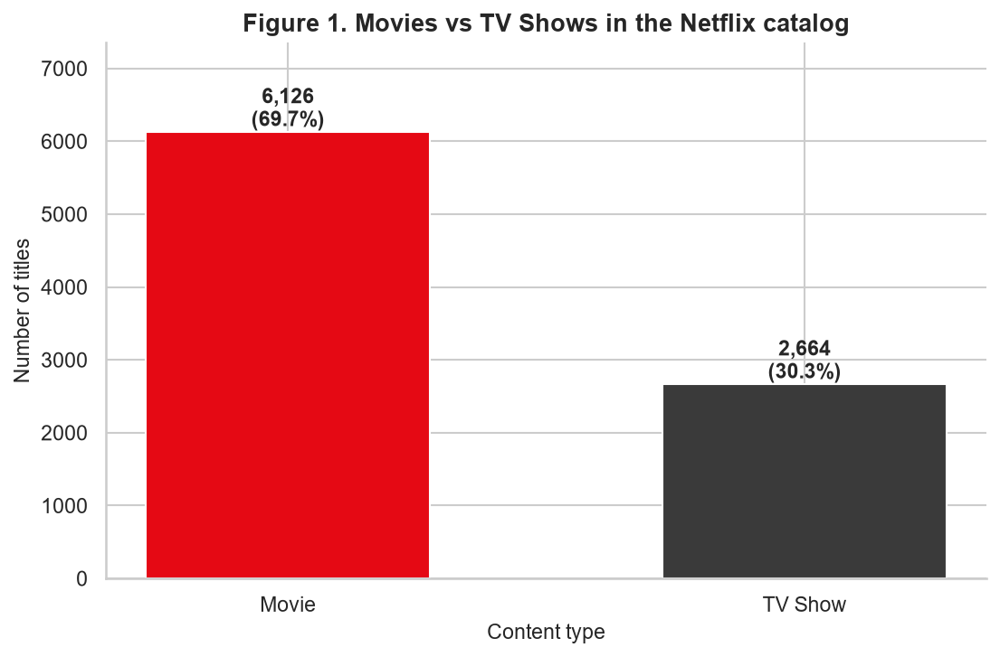
*Figure 1: Breakdown of Movies vs. TV Shows in the catalog snapshot.*

### 2. Annual Catalog Ingestion Trends
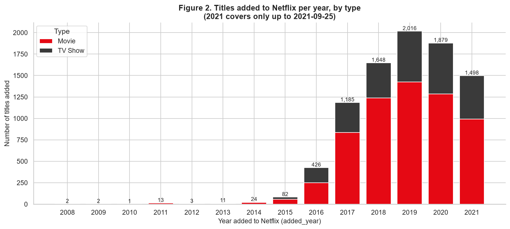
*Figure 2: Number of titles added per year by content type, showing rapid expansion between 2016 and 2019.*

### 3. Distribution of Original Release Years
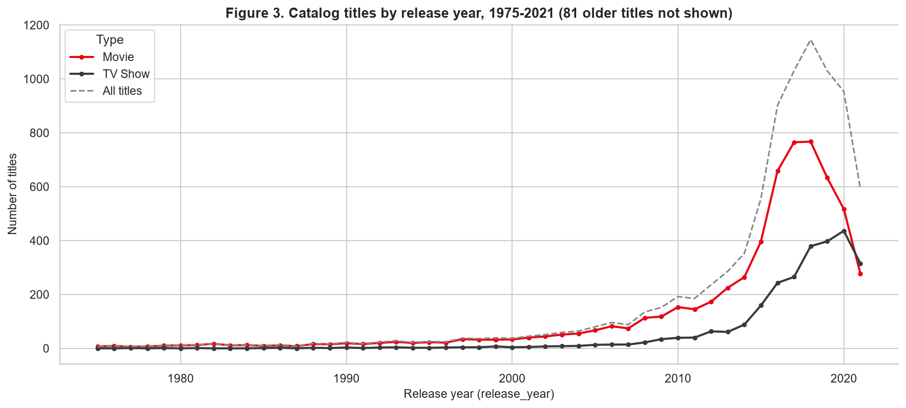
*Figure 3: Catalog distribution across original production release years.*

### 4. Top Producing Countries
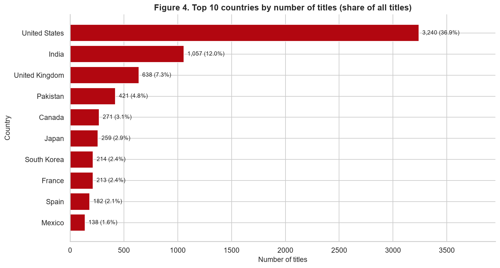
*Figure 4: Leading 10 production nations based on exploded multi-country records.*

### 5. Most Prevalent Content Genres
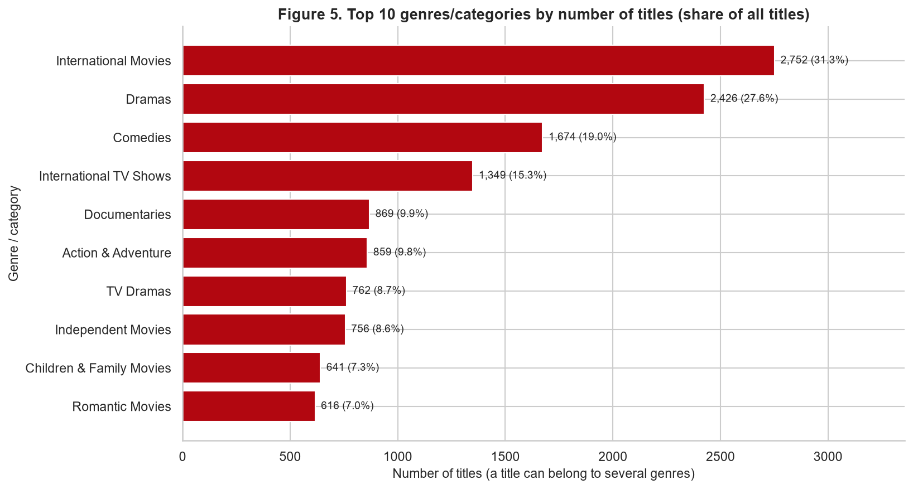
*Figure 5: Top 10 exploded categories across the entire streaming catalog.*

### 6. Maturity Rating Distribution
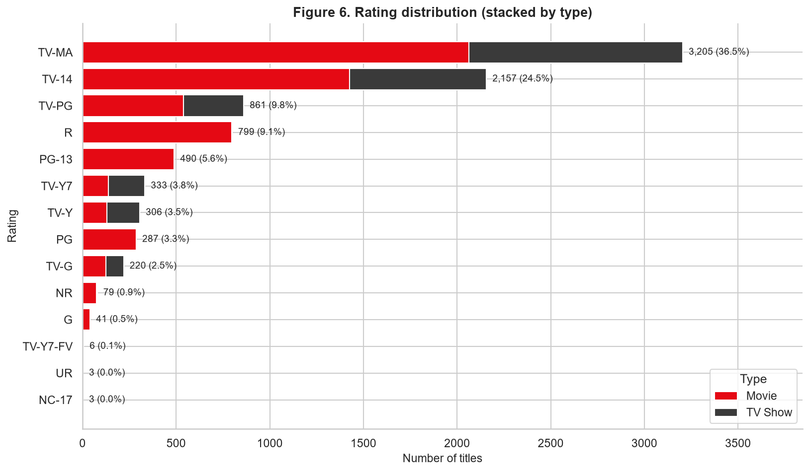
*Figure 6: Content maturity ratings stacked by Movies and TV Shows.*

### 7. Movie Runtime Profile
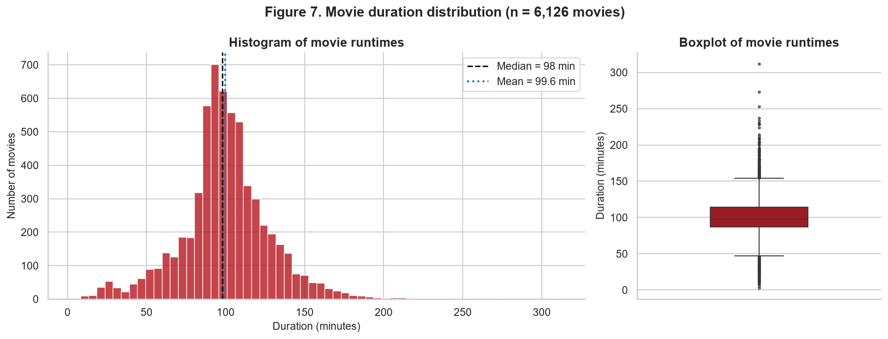
*Figure 7: Histogram and boxplot of film runtimes in minutes ($N = 6,126$).*

### 8. TV Show Season Distribution
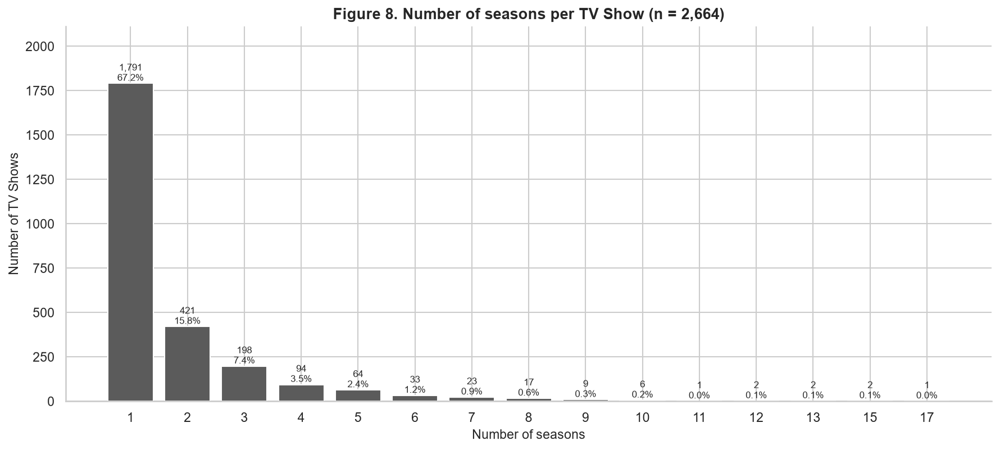
*Figure 8: Steep right-skewed distribution of television series seasons ($N = 2,664$).*

### 9. Decadal Genre Prevalence Heatmap
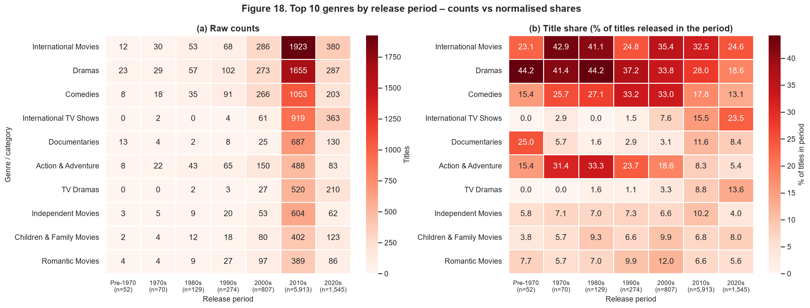
*Figure 18: Comparison of raw title counts versus normalized title share across release periods.*

### 10. 100% Stacked Genre Share Evolution
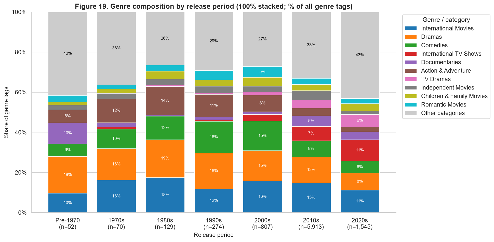
*Figure 19: Proportional shift in genre composition from vintage classic cinema to international streaming content.*

### 11. Numeric Correlation Heatmaps
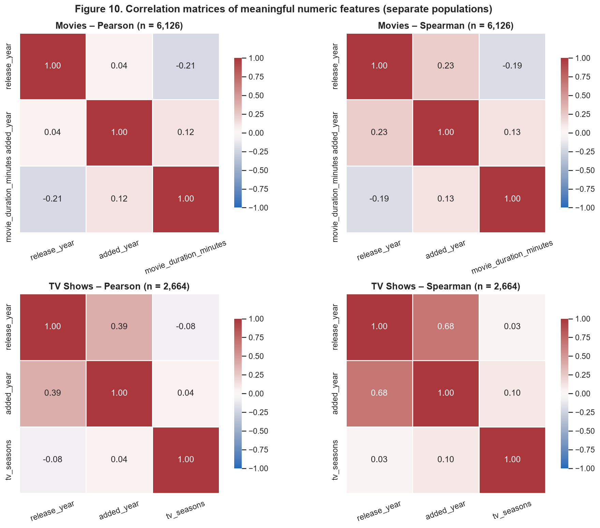
*Figure 10: Pearson and Spearman correlation matrices evaluated on separate Movie and TV Show populations.*

---

## 📁 Repository Structure

```
synent-task3-netflix-eda-ahmed/
│
├── README.md                          # Comprehensive project documentation
├── LICENSE                            # MIT Open Source License
├── requirements.txt                   # Complete Python package dependencies
├── .gitignore                         # Standard git ignore rules (caches, environments, temp files)
│
├── data/
│   ├── raw/
│   │   └── Dataset.csv                # Untouched raw catalog snapshot (8,790 rows)
│   └── processed/
│       └── netflix_cleaned.csv        # Cleaned dataset with engineered features
│
├── notebooks/
│   ├── netflix_eda.ipynb              # Main executable EDA notebook (runs top-to-bottom)
│   └── images.jpg                     # Project branding logo
│
├── figures/                           # 22 publication-quality generated PNG figures
│   ├── content_type_distribution.png
│   ├── titles_added_by_year.png
│   ├── releases_by_year.png
│   ├── top_countries.png
│   ├── top_genres.png
│   ├── rating_distribution.png
│   ├── movie_duration_distribution.png
│   ├── tv_show_seasons_distribution.png
│   ├── correlation_heatmap.png
│   ├── genre_by_release_decade_heatmap.png
│   ├── genre_share_by_decade.png
│   └── ... (additional detailed visual figures)
│
├── reports/
│   └── insights_summary.md            # Written summary of empirical insights
│
└── demo_video/
    └── Screen Recording...mp4         # Demonstration video recording
```

---

## ⚠️ Limitations & Analytical Caveats

1. **Snapshot Nature:** The data represents a static catalog snapshot. Expired licenses and removed titles are absent, which naturally underrepresents earlier addition volumes.
2. **Absence of Engagement Data:** Viewing hours, box office revenue, completion rates, and subscriber ratings are unavailable. Genre frequencies represent **catalog availability**, not subscriber demand.
3. **Correlation is Not Causality:** Numeric relationships reflect licensing conventions and operational definitions, not causal entertainment drivers.
4. **Distinct Duration Measures:** Film minutes and TV seasons are distinct units and must never be merged into a single metric.
5. **Right-Censored TV Seasons:** Series released recently have had less time to produce subsequent seasons compared to older programs.

---

## 🚀 How to Run & Reproduce

Follow these steps to set up the environment and execute the notebook:

### 1. Clone the Repository
```bash
git clone https://github.com/ahmedmahmoudkhalifa300/Synent-Technologies.git
cd Synent-Technologies/Task3_Netflix_EDA
```

### 2. Create and Activate Virtual Environment
```bash
# Windows
python -m venv .venv
.venv\Scripts\activate

# macOS / Linux
python3 -m venv .venv
source .venv/bin/activate
```

### 3. Install Dependencies
```bash
pip install --upgrade pip
pip install -r requirements.txt
```

### 4. Launch Jupyter Notebook
```bash
jupyter notebook notebooks/netflix_eda.ipynb
```

The notebook will execute cleanly from top to bottom, validating all 13 reproducibility checks and re-saving all figures in `figures/`.

---

## 🎓 Internship Submission Details

- **Student Name:** Ahmed Mahmoud Khalifa
- **Internship Organization:** Synent Technologies
- **Track:** Data Science
- **Task:** Task 3 — Exploratory Data Analysis (EDA)
- **GitHub Profile:** [@ahmedmahmoudkhalifa300](https://github.com/ahmedmahmoudkhalifa300)
- **Project Repository:** [Synent-Technologies](https://github.com/ahmedmahmoudkhalifa300/Synent-Technologies)
- **Demonstration Video:** Located in [`demo_video/`](demo_video/)
